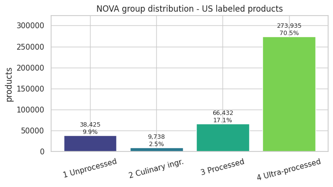
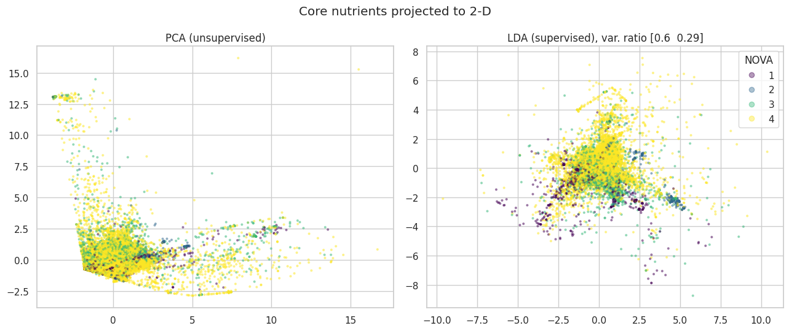

# NOVA-Net

**Predicting the processing level of packaged foods (NOVA group 1–4) from nutrition facts, ingredient text and categories.**

Final project for **AID 427 – New Trends in Data Science**, Egypt-Japan University of Science and Technology (E-JUST).
This repository holds **Phase 1: exploratory analysis of the United States subset of Open Food Facts**.

---

## The problem

Ultra-processed food is linked to obesity, type 2 diabetes and heart disease, but processing level is not printed on food packages. The [NOVA classification](https://world.openfoodfacts.org/nova) rates processing from **1** (unprocessed or minimally processed) to **4** (ultra-processed). In Open Food Facts, only **23.3%** of the 4.8 million products have a NOVA group.

NOVA-Net aims to build a multi-class classifier that predicts `nova_group` for products that don't have one.

## Repository contents

```
NOVA-Net/
├── notebooks/
│   └── NOVA_Net_Phase1_EDA_US.ipynb     # Phase 1 analysis (Colab, outputs included)
├── paper/
│   ├── main.tex                         # IEEE conference paper (LaTeX source)
│   ├── figures/                         # charts exported from the notebook
│   └── NOVA_Net_paper.pdf               # compiled paper
├── docs/
│   └── NOVA-Net_Phase1_Documentation.pdf  # project idea, methodology, results, interpretation
└── README.md
```

## Dataset

| | |
|---|---|
| Source | [Open Food Facts](https://world.openfoodfacts.org/data), Parquet export on [Hugging Face](https://huggingface.co/datasets/openfoodfacts/product-database) (`food.parquet`, 7.7 GB) |
| License | Open Database License (ODbL) |
| Scope | Products whose `countries_tags` contains `en:united-states` |
| Size | 993,157 US products: 388,530 labeled, 604,627 unlabeled |
| Target | `nova_group` ∈ {1, 2, 3, 4} |
| Features | Nutrients per 100 g, ingredient text, categories, labels, additives, allergens, brands, packaging |

The export is refreshed regularly, so counts shift slightly between downloads.

## Method (Phase 1)

1. **Load** the Parquet file with DuckDB, which reads only the needed columns, so the analysis runs on free Colab.
2. **Subset** to US products and **flatten** the nested nutrient records into 20 per-100 g columns.
3. **Remove target leakage**: `nova_groups`, `nova_groups_tags`, and a `nova-group` entry hidden inside the nutrient list.
4. **Explore**: class balance, missing values (labeled vs unlabeled), impossible values, correlations, ingredient-text quality, high-cardinality tags, TF-IDF + SVD dimensionality, and class separation (PCA, LDA, silhouette, mutual information).
5. **Clean**: impossible nutrient values (negative, > 100 g per 100 g, > 900 kcal, inconsistent sub-totals) are set to missing, and the cleaned tables are saved as Parquet.

## Key findings

| Finding | Number |
|---|---|
| Class imbalance | NOVA 4 = 70.5%, NOVA 3 = 17.1%, NOVA 1 = 9.9%, NOVA 2 = 2.5% (28:1) |
| Ingredient text missing | 1.1% of labeled products vs **88%** of unlabeled products |
| Unlabeled products with ingredient text | 69,953 of 604,627 (11.6%) |
| Products with impossible nutrient values | up to 4.0% of labeled products |
| Strongest features | ingredient count (Spearman ρ = 0.61), additive count (ρ = 0.65) |
| Text dimensionality | 35,432 TF-IDF features, 0.17% density; 100 SVD components keep 24.5% of the variance |
| Class separation in nutrient space | silhouette ≈ 0 (PCA −0.047, LDA −0.011), while mutual information stays positive |

**What this means for modelling.** Open Food Facts *computes* NOVA from ingredients and categories with a rule-based formula. A missing label therefore usually means missing ingredients, and the strongest features partly reproduce that formula. Phase 2 will use macro-F1 and per-class recall with class weights, and will report ablations with and without the formula-related features, plus a nutrition-only model.

<p align="center">
  
  
</p>

## How to reproduce

1. Open `notebooks/NOVA_Net_Phase1_EDA_US.ipynb` in [Google Colab](https://colab.research.google.com/) (a standard CPU runtime is enough; High-RAM helps).
2. **Runtime → Run all.** The notebook downloads `food.parquet` from Hugging Face (about 2 minutes) and runs end to end.
3. Outputs are written to `/content/nova_outputs/`: `us_labeled_clean.parquet`, `us_all_clean.parquet` and `phase1_summary.json`. To keep them, set `SAVE_TO_DRIVE = True` in the config cell.

To build the paper, upload the `paper/` folder to Overleaf, or run `latexmk -pdf main.tex` with a TeX Live install that includes `IEEEtran`.

## Roadmap

- [x] Phase 0: project proposal
- [x] Phase 1: data loading, cleaning and exploratory analysis (US)
- [ ] Phase 2: feature encoding and dimensionality reduction (SVD, PCA, Kernel-PCA, LDA, SNE, t-SNE, UMAP)
- [ ] Phase 3: baseline, nonlinear and combined text + numeric classifiers; evaluation and ablations
- [ ] Later: more countries, and product images if time allows

## Team

| Name | Student ID |
|---|---|
| Omar Ahmed Elwekeil | 320230172 |
| Ahmed Abdelmaksoud | 320230212 |

AID 427 – New Trends in Data Science · Lab section 4 · E-JUST

## Acknowledgements

Data from [Open Food Facts](https://world.openfoodfacts.org), available under the Open Database License.
